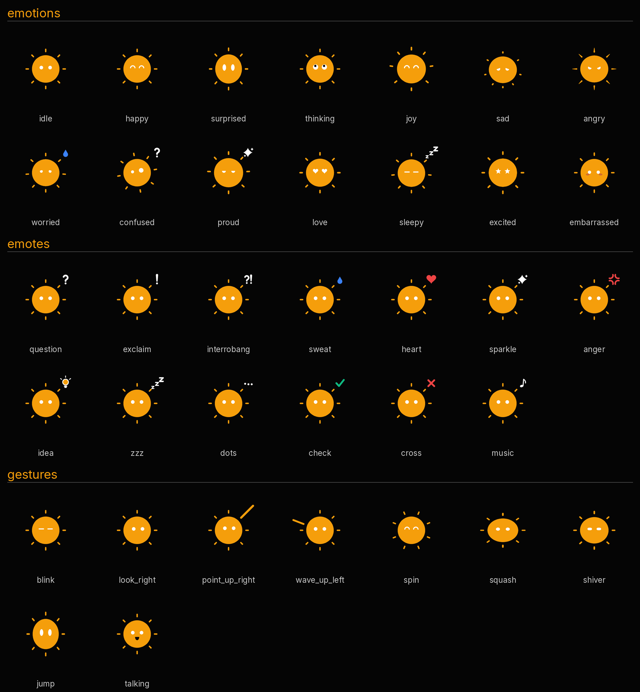

# 品牌角色：小太陽

| 項目 | 內容 |
|---|---|
| 適用範圍 | 桑尼資料科學的片子裡出現的角色：長什麼樣子、每個表情什麼時候用、在畫面哪裡走動、不能怎麼用。給 Agent 和做片的人讀 |
| 相關文件 | 給程式讀的數值：[brand.json](../brand.json) 的 `mascot`；品牌規則：[BRAND.md](../BRAND.md)；色彩：[color-palette.md](../guideline/color-palette.md)；畫面風格：[3b1b](../../../styles/3b1b/STYLE.md)<br>程式：[helpers/mascot.py](../../../helpers/mascot.py)（形狀、動作、時間軸、貼圖）、[helpers/compose.py](../../../helpers/compose.py)（合成時每格即時畫角色）、[helpers/mascot_track.py](../../../helpers/mascot_track.py)（固定大小的透明軌，給其他流程）、[helpers/mascot_qa.py](../../../helpers/mascot_qa.py)（指向、遮擋、走道的 QA）、[templates/manim/sun_mascot.py](../../../templates/manim/sun_mascot.py)（Manim 元件） |
| 狀態 | 2026-11-22 升級成「會說話、會走動的小精靈」：嘴巴跟著旁白、身體跟著聲音起伏、在走道裡滑行和跳躍。同日加上 10 種情緒、13 種符號（emote），`point`／`look` 可以用 `target` 對準畫面上的實際位置，並有 `mascot_qa.py` 檢查。嘴巴預設改成 `d`（上平下圓） |

## 概念

**一個形狀加一雙眼睛，靠動作活起來。它是跟在主人旁邊的小精靈，替旁白說話。**

- 一個實心的琥珀色圓，外面一圈 8 個分開的短刻痕（最簡單的太陽），兩顆白色圓點眼睛；旁白在說話的時候，眼睛下面多一張深色的小嘴。沒有手腳、漸層、外框、陰影。
- 為什麼這麼少：解說片的主角是內容，角色是陪觀眾一起反應的小夥伴。東西越少，越不會搶走注意力，縮小到 120 px 也認得出來。
- 生命感來自動作，不是細節：漂浮、眨眼（每次不太一樣）、看向某處、跟著旁白的音量張嘴、跟著音調高低浮起來、被嚇到時跳一下、說錯時發抖、在畫面下方的走道裡滑過去或跳過去。只借用「會呼吸的圓點」這類設計的想法，不模仿任何公司的標誌或造型。
- 白點眼睛和品牌 logo 上的白點是同一個語彙：觀眾看到角色的眼睛，會連到桑尼資料科學的標誌。
- 名字裡的「桑尼」＝Sunny，所以是太陽。

## 造型和顏色

所有數值只寫在 [brand.json](../brand.json) 的 `mascot`（動作的數值可以在 `mascot.motion` 覆蓋程式的預設，預設值在 `helpers/mascot.py` 的 `MOTION`），這份文件不重複數字的細節。

| 部位 | 規則 |
|---|---|
| 身體 | 實心圓，半徑 `geometry.body_r`（1 個單位，其他尺寸都以它為準） |
| 刻痕 | `geometry.rays` 個（8 個），圓頭短線，從 `ray_inner` 到 `ray_outer`，寬 `ray_width`；和身體之間一定要有空隙 |
| 眼睛 | 兩顆白色實心圓，左右各 `eye_dx`、高度 `eye_y`、半徑 `eye_r` |
| 嘴巴 | **只在旁白說話時出現**，深色（`pupil` 色），在眼睛下方，張開的大小跟著音量；沒聲音時收起來看不到。造型由 `motion.mouth` 決定（見下節） |
| 顏色 | 身體和刻痕：CIS Amber `#F59E0B`（`color`）；眼睛：白 `#FFFFFF`（`eye`）；思考時的瞳孔和嘴巴：`#050505`（`pupil`，和品牌底色同一個黑） |

為什麼是 CIS Amber：原提案的橘色 `#FF9F43` 不在 CIS 裡，Expert `#CC7A29` 在黑底上太暗。琥珀色和品牌主色 Teal、Mint 互補，放在品牌色旁邊最跳。

### 嘴巴（造型可以換，不用改程式）

`brand.json` 的 `mascot.motion.mouth`：

| 欄位 | 意思 |
|---|---|
| `shape` | `d`（上平下圓，像側放的 D，目前用這個）、`oval`（小橢圓）、`round_rect`（圓角長方形） |
| `w` | 嘴寬（身體半徑的倍數） |
| `h_open` | 張到最大時的高度 |
| `h_closed` | 說話中但音量很小時的高度（一條細線） |
| `y` | 嘴巴中心的高度（負數在中心下方） |
| `round` | `round_rect` 的圓角程度 |

嘴巴怎麼動：旁白的音量（每格的響度，最大聲那 12 dB 的範圍）決定張多大；說話中字和字之間的短空檔（約 0.36 秒以內）嘴巴閉成細線但還在；停頓更久就收起來。使用者選定造型後，只改 `shape` 和尺寸，再重新產生貼圖。

## 表情和手勢

表情名稱是固定的（程式和分鏡檔都用這些名字）。一般表情會維持一段時間（`hold`，預設 1.6 秒）再回到 idle；其他是一次性的動作。表情之間的轉換 0.25 秒，緩進緩出。

| 名稱 | 樣子 | 什麼時候用 |
|---|---|---|
| `idle` | 圓點眼睛，輕輕上下漂浮（±6 px、約 2.4 秒一次）和左右微擺（±3°），每 2.5–5 秒眨一次眼：一般眨、連眨兩下、慢慢眨、瞇一下，輪流出現（固定的亂數種子，每次輸出都一樣） | 預設狀態 |
| 說話（自動） | 旁白說話時嘴巴出現、跟著音量開合，身體跟著音量微微拉高；音調高的地方身體浮起來（最多約 10 px）並稍微歪一點 | 不用寫，配音有聲音就會動 |
| `blink` | 眼睛閉成一條短橫線，約 0.15 秒 | 段落之間的停頓、講完一句重點後的「嗯」 |
| `look`（方向） | 眼珠往那個方向移一點 | 帶觀眾的視線：「看這個數字」時看向數字；有東西出現時看過去 |
| `surprised` | 眼睛變成直立的橢圓（高 1.7 倍），身體微微拉高，**原地跳一下**（約 40 px，落地壓扁） | 出乎意料的結果：「不是 0.3，而是這一長串」 |
| `thinking` | 眼睛變大，出現黑色小瞳孔往上看 | 向觀眾拋出問題：「那電腦呢？」「寫程式的人怎麼辦？」 |
| `happy` | 眼睛變成向上的弧線（像 ^ ^），刻痕那一圈轉一下 | 正確、成立、問題解決：`True`、「一分都不差」 |
| `squash` | 身體壓扁約 0.12 秒，再用 0.35 秒彈回來 | 「存不進去」這類被打臉的瞬間 |
| `shiver` | 左右快速小幅發抖約 0.35 秒，眼睛瞇一下 | 錯、「≠」、「不是」 |
| `point`（方向） | 最靠近那個方向的刻痕伸得很長（約 2.6 倍半徑）變粗，身體往那邊傾，眼睛也看過去；結束時縮回來 | 指著正在被點名的東西：「多了一個 4」「這種方式叫做浮點數」 |
| `wave`（方向） | 一根刻痕伸出來揮三下 | 開場打招呼、片尾道別 |
| `spin` | 刻痕那一圈轉 90° | 開心、完成（`happy` 會自動帶一次） |
| `jump` | 原地跳一下（`surprised` 會自動帶一次） | 想要強調、但不是驚訝的時候 |

方向可以用：`right`、`left`、`up`、`down`、`up-right`、`up-left`、`down-right`、`down-left`。`point` 和 `look` 最好改用 `target`（見「指向要對準畫面上的實物」），`dir` 只在沒有明確目標時用。

### 情緒（喜怒哀樂）

情緒和 `happy`、`thinking` 一樣是**維持型**的表情（`"do": "<名稱>"`，維持 `hold` 秒再回到 idle）。原本的名稱照舊能用：`happy` 是輕鬆的開心（弧線眼＋轉一圈），`joy` 是更大的喜悅；`surprised`、`thinking` 不變。情緒只改眼睛、刻痕和身體的形狀，**不改身體的顏色**。

| 名稱 | 樣子 | 什麼時候用（解說片） |
|---|---|---|
| `joy` | 弧線眼（^ ^），身體膨起來一點，刻痕往上翹、往外推 | 大的好消息、問題終於解開：「一分都不差」 |
| `sad` | 眼睛上半被切掉、外側往下垂，身體往下沉一點，刻痕下垂、變短 | 壞消息、「可惜」：「位數有限，只能四捨五入」 |
| `angry` | 眼睛上緣斜切（內側低），身體快速小幅發抖，刻痕變長、變尖 | 被坑、不公平：「明明沒算錯卻被說錯」（少用，品牌調性偏溫和） |
| `worried` | 小眼睛左右看，自帶藍色汗滴 `sweat` | 陷阱、風險：「拿 == 比小數會出事」 |
| `confused` | 一眼大一眼小，頭歪一邊，自帶 `?` | 觀眾的疑問、反直覺的地方：「0.1 加 0.2 怎麼不是 0.3？」 |
| `proud` | 眼睛半閉、滿足，身體稍微變大，自帶白色星光 `sparkle` | 解法成立、學會了：「改用整數存 10 分」 |
| `love` | 眼睛變成白色愛心 | 喜歡的技巧、優雅的解法（一支片最多一次） |
| `sleepy` | 眼睛是兩條線，身體稍微下沉，自帶 `zzz` | 冗長、無聊的做法：「一顆一顆慢慢加」 |
| `excited` | 眼睛變成白色星星，原地小跳 | 期待接下來的東西：「我們來秤出剛好 0.1」 |
| `embarrassed` | 眼睛往下看，眼睛下方出現 Featured Red `#BA4D43`、約 60 % 不透明的腮紅 | 自己（或常見的直覺）說錯了：「其實不是電腦的錯」 |

會動的部分（發抖、小跳、左右看、自帶的符號）只在合成時出現；貼圖和透明軌以外的流程用 `mascot.target_pose` 拿到的是靜止的那一格。

### 符號（emote）

符號是畫在頭的右上方（太靠右邊、會跑出畫面時自動換到左上方）的扁平圖形，用多邊形畫，不用字型。出現時 0.2 秒內從 0 放大到 1.1 再回到 1（`emote_pop`），停留時輕輕上下浮動，結束時 0.25 秒淡出。寫法：事件加 `"emote": "<名稱>"`，可以和 `do` 一起寫，也可以單獨寫；`"emote_hold"` 是停留秒數（預設 1.2 秒；情緒自帶的符號跟著情緒的 `hold`）。

| 名稱 | 樣子 | 顏色 | 什麼時候用（解說片） |
|---|---|---|---|
| `question` | ? | 白 | 替觀眾發問的那一拍：「那電腦呢？」 |
| `exclaim` | ! | 白 | 出乎意料的結果：「而是這一長串」 |
| `interrobang` | ?! | 白 | 又驚又疑：結果和直覺完全相反 |
| `sweat` | 水滴，慢慢往下滑 | Info `#3B82F6` | 陷阱、踩坑、尷尬 |
| `heart` | 愛心，輕輕跳動 | Error `#EF4444` | 喜歡、推薦（不是對錯） |
| `sparkle` | 三顆白色四角星，輪流閃 | 白 | 漂亮的解法、重點完成 |
| `anger` | 十字形的「青筋」記號 | Error `#EF4444` | 不爽、被坑（少用） |
| `idea` | 小燈泡：白色外圈＋琥珀色燈泡、三道光 | 白＋Amber | 關鍵觀念出現：「這種方式叫做浮點數」 |
| `zzz` | 三個 Z 依序出現、往上飄 | 白 | 無聊、冗長、等很久 |
| `dots` | 三個點輪流跳 | 白 | 思考中、「嗯……」的停頓 |
| `check` | 打勾 | Success `#10B981` | True、成立、答對：「它說：等於」 |
| `cross` | 叉叉 | Error `#EF4444` | False、不成立、答錯：「電腦老實回答：不等於」 |
| `music` | 八分音符，左右輕擺 | 白 | 輕鬆的轉場、片尾 |

顏色寫在 [brand.json](../brand.json) 的 `mascot.emotes.colors`（只能用 CIS 色）；腮紅的顏色和不透明度是 `mascot.emotes.blush`、`blush_opacity`。

**頻率**：符號比表情更搶眼。一支 3 分鐘的短片大約 4–6 個符號，同一個符號不要連續兩句用；`check`／`cross` 只給真正的 True/False（對錯）時刻；`anger`、`love`、`heart` 一支片最多一次。情緒大約一句最多一個，維持型情緒不要連續超過 3 秒。符號會畫在頭上方約 80 px 的地方：說明動畫壓到走道附近的時候，先用 `mascot_qa.py` 看會不會蓋到內容（會的話把角色移到另一側再出符號）。

### 指向要對準畫面上的實物（target）

`point` 和 `look` 是在說「看這裡」，指錯方向比不指更糟。所以：

- **影片裡每一個 `point`、`look` 都要寫 `target`**：`"target": [x, y]`，1080×1920 座標，指向（或看向）的那個東西的中心。寫了 `target` 就不用 `dir`（兩個都寫時以 `target` 為準）。
- 程式怎麼算：用那個時間點角色的中心（已經移動完的位置）到 `target` 的向量；眼睛看同一個方向、身體往那邊傾；`point` 挑最接近那個方向的刻痕伸出去，再把整圈刻痕轉一個小角度（伸出時緩進、收回時緩出），讓伸出的刻痕剛好對準 `target`（傾身、搖擺、說話時的拉長都算進去）。
- 符號也可以寫 `target`：符號出現時眼睛看向那裡。
- **座標怎麼找**：在那一句字幕的時間點，從鏡頭的素材截一格（和合成一樣的畫面：`compose.shot_command` 截 1 格，或看 `mascot_qa.py` 的圖），用看圖軟體或程式找出那個東西的外框，取中心。例如 `浮點數_0.1加0.2`：終端機裡最後的「4」在 [766, 692]、第一組「0011」在 [340, 1068]、「浮點數」標題在 [540, 338]。動畫有鏡頭推拉時，取指著的那段時間中間那一格的位置。
- **給使用者看預覽之前一定要跑 QA**：

```
uv run python helpers/mascot_qa.py <影片資料夾>/edit/合成.json
```

輸出 `<影片資料夾>/edit/mascot_qa/`：每個 `point`／`look` 在維持時間中間那一格的合成畫面（畫面、角色、文字都和合成一樣），上面畫 `target` 的十字和沿著刻痕（`look` 是沿著眼睛）的黃線；`report.md` 列出每一項的結果和角度誤差。不合格（exit 1）的條件：指向和目標差超過 8°、刻痕沒伸出來；每 0.2 秒檢查一次，角色（含符號）蓋住畫面內容超過 40 px（字幕和標題不算內容）；角色離開走道（跳躍可以高出 `lane_rise_px`）。沒寫 `target` 的 `point`／`look` 是 WARN。有 FAIL 就改分鏡再跑，全部通過才給預覽。

貼圖一覽（[sheet.png](stickers/sheet.png)，分成 emotions／emotes／gestures 三段）：



## 放在畫面哪裡、怎麼走動（9:16 直式）

位置用 1080×1920 的座標。起點（家）和大小在風格的 `style.json` 的 `mascot`：`x`、`y` 是中心，`size` 是顯示大小（`size` 的一半約等於 2.6 個身體半徑，3b1b 的 300 → 身體直徑約 115 px）。

### 硬規則：絕對不蓋住主要的說明動畫

- 角色只能在**角色走道**裡移動：`style.json` 的 `mascot.lane`，`{"x": [x0, x1], "y": [y0, y1]}` 是角色中心可以去的範圍。3b1b 的走道是說明動畫下緣和字幕之間的那一條（y 1470–1600），左右各留一點邊。
- 每個移動目標（`to`）都會被夾進走道裡；被夾到時合成程式會印出「注意：…超出角色走道」，看到就改分鏡。
- 跳躍（`hop`、`surprised`、`jump`）最高只能比走道上緣高 60 px（`lane_rise_px`），不會跳進動畫的區域。
- **預設的走法：沿著走道左右移動，往正在講的東西那一側靠**（`"to": "left"`、`"right"`、`"center"`），不要往上走進內容。
- 字幕永遠畫在角色上面（畫的順序：畫面 → 角色 → 段落標題卡、數字卡、logo、標題、字幕），角色不會擋到字幕；段落標題卡出現時角色被蓋住是正常的。

### 走動的規則

- 不要擋到正在說明的東西，挑空的地方站；靠近內容時用 `size` 縮小一點。
- 一段講完就回家（`"to": "home"`）。
- 大動作（`hop`、跨過半個畫面的 `glide`）大約每 8 秒最多一次；表情大約一句話最多一個。角色一直動，觀眾會一直看它，而不是看內容。
- 右下角是 Shorts 的按讚、留言、分享按鈕，角色停在右邊的時間不要太長。
- 長片（16:9）：右下或左下角，同樣避開字幕和內容；身體直徑約畫面高度的 8–12%。

## 不要做的事

- 不改顏色（不換色、不加漸層、不做成透明或描邊版）。背景一律是深色；淺色背景上要用時先問。
- 不加東西：手腳、眉毛、帽子、道具、陰影、發光，都不加（腮紅只有 `embarrassed` 會出現，頭旁邊的符號只用下面「符號」那張表裡的）。嘴巴只在旁白說話時出現，旁白沒在說話時不畫嘴巴（也不做成一直笑著的嘴）。
- 不閃爍、不無限旋轉；動作要有目的（看、指、跳、走過去），不是一直亂動。
- 不蓋住正在解說的東西，不離開角色走道，不壓字幕。
- 不在角色旁邊加對話框或文字：角色替旁白「說話」只用嘴型和動作，字還是字幕的事。符號（`?`、`!`、打勾……）是畫出來的圖形，不是字型，也不算文字。
- 情緒不改身體的顏色（生氣不變紅、難過不變藍）：情緒只靠眼睛、刻痕、身體的形狀和符號表現。

## 怎麼用

### 1. 合成科普短片（每格即時畫）

在 `合成.json` 寫事件，`at` 是字幕文字（對位規則和鏡頭的 `from` 一樣，依序往後找）：

```json
"mascot": {"seed": 0, "events": [
  {"at": "請電腦算 0.1 加 0.2", "to": "center"},
  {"at": "而是這一長串", "do": "surprised", "emote": "exclaim"},
  {"at": "多了一個 4", "do": "point", "target": [766, 692], "hold": 2.0, "to": [760, 1500], "size": 260},
  {"at": "那電腦呢？", "do": "confused"},
  {"at": "不等於", "do": "shiver", "emote": "cross", "offset": 0.2},
  {"at": "我們下次見", "do": "wave", "to": "home", "move": "hop"}
]}
```

| 欄位 | 意思 |
|---|---|
| `at` | 字幕文字，事件從那一句字幕開始的時間起算 |
| `do` | 表情或情緒名稱（上面的表）；只想移動或只出符號時可以不寫 |
| `target` | `point`、`look` 要對準的畫面位置 `[x, y]`（1080×1920）；符號事件寫了就看向那裡。影片裡的 `point`／`look` 都要寫 |
| `dir` | 沒有 `target` 時 `look`、`point`、`wave` 的方向 |
| `emote` | 頭旁邊的符號（「符號」那張表），可以和 `do` 一起寫 |
| `emote_hold` | 符號停留幾秒，預設 1.2（情緒自帶的符號跟著情緒的 `hold`） |
| `hold` | 維持幾秒再回到 idle，預設 1.6（一次性的動作不用寫） |
| `offset` | 從字幕開始再延後（或提早，負數）幾秒 |
| `to` | 移動目標：`[x, y]`（1080×1920 座標，會夾進走道），或 `home`（回家）、`left`、`right`、`center`（走道的左端、右端、中間，高度同家） |
| `move` | `glide`（預設，約 0.8 秒的平滑滑行，中途微微浮起）或 `hop`（約 0.6 秒的跳躍：先蹲、拋物線、落地壓扁） |
| `size` | 移動後的顯示大小（px），靠近內容時縮小用 |

角色移動後停在那裡，直到下一個 `to`；移動時眼睛看著前進的方向。

合成時 `compose.py` 直接畫角色，不用先產生透明軌（給使用者看之前先跑 `mascot_qa.py`，見「指向要對準畫面上的實物」）：

```
uv run --project . python helpers/compose.py <影片資料夾>/edit/合成.json
```

第一次會分析配音的音量和音高（`librosa.pyin`），存在 `<影片資料夾>/edit/mascot/voice_features.npz`；配音檔改了會自動重算。

### 2. 透明軌（其他流程要一個固定大小的角色影片時）

```
uv run python helpers/mascot_track.py <影片資料夾>/edit/合成.json
```

輸出 `<影片資料夾>/edit/mascot/track.mov`：300×300、30 fps、含 alpha（qtrle），長度和配音總長（含片尾 1.5 秒）完全相同。表情、情緒、符號、眨眼、嘴型和合成時一樣，但**不含位置**（`to`、跳躍、漂浮），因為軌道本身是固定的一格。

### 3. Manim 元件（動畫裡讓角色出場）

```python
import sys; sys.path.insert(0, r"<repo>/templates/manim")
from sun_mascot import SunMascot

sun = SunMascot(size=0.6).to_corner(DL)
self.play(sun.surprised()); self.play(sun.to_idle())
self.play(sun.talk([0.2, 0.9, 0.4, 1.0], run_time=1.0))
```

方法：`blink(kind)`、`look(dir)`、`surprised()`、`thinking()`、`happy()`、`squash()`、`point(dir)`、`to_idle()`、`idle(秒數)`、`talk(音量, run_time)`、`wave(dir)`、`spin()`、`shiver()`、`jump(高度)`、`emotion(名稱)`、`emote(名稱, hold)`（和情緒一起播：`self.play(AnimationGroup(sun.emotion("confused"), sun.emote("question")))`）。用法寫在檔案開頭的說明。

### 4. 貼圖

[stickers/](stickers/) 裡每個表情一張 512×512 透明 PNG，給縮圖、社群貼文、簡報用：情緒（`idle`、`happy`、`surprised`、`thinking` 和 10 種情緒，自帶符號的會畫上符號）、符號（`emote_<名稱>`，畫在 idle 的角色旁邊）、手勢（`blink`、`look_right`、`point_up_right`、`wave_up_left`、`spin`、`squash`、`shiver`、`jump`、`talking`）。改了 brand.json 的數值後重新產生：

```
uv run python helpers/mascot.py --stickers
```

想先看各個表情動起來的樣子：`uv run python helpers/mascot.py --demo <輸出.mp4>`（約 10 秒，黑底，依序播過每個表情）。
